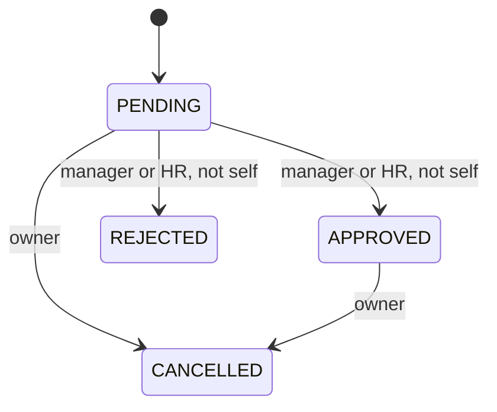

# Ownership, state machines, intervals, and transactions

A role is only part of authorization. A manager can review their own profile and direct reports, but cannot decide every employee's leave. The server combines verified identity with the current reporting relationship. HR can review leave across the organization, yet still cannot approve their own request. The UI displays appropriate controls, while the API independently enforces the same rules.

The leave workflow has explicit states:

Only an owner can edit or delete a pending request. Accepted decisions are not overwritten with arbitrary status strings. Cancellation retains the previous decision information and adds its own audit event. This differs from deletion, which removes a pending record while retaining minimal audit metadata.

Dates are calendar days, not arbitrary timestamps. The API accepts canonical YYYY-MM-DD values and checks real dates, ordering, and a bounded inclusive span. PostgreSQL stores them as date columns. A request from July 10 through July 12 includes July 12; another starting July 12 overlaps. A request starting July 13 does not. The system does not calculate workdays, holidays, balances, or policy entitlements.

Two layers protect overlap. The application locks the employee row while checking and creating or editing an active interval. Cooperating requests for the same employee therefore serialize. A PostgreSQL exclusion constraint independently rejects overlapping pending or approved intervals, including writes that bypass repository validation. The application check provides a clear error; the database constraint protects the invariant.

Versions preserve draft intent. A loaded request at version one must send expected version one, even if another tab has since saved version two. Fetching the latest version and attaching it to an old draft would bypass that protection. Conditional updates and deletes include the baseline version, while the UI retains rejected input for export and reconciliation.

Transactions group the entity change and audit insertion. If audit insertion fails, the mutation rolls back. Employee updates additionally group User name/email with Employee position, department, and reporting fields. That prevents a partial update where a person's identity changes but their profile version does not.

Reporting relationships introduce a graph invariant: cycles are forbidden. Employee mutations use a transaction-level advisory lock while validating the manager chain, preventing two individually plausible concurrent changes from creating a cycle together. The lock coordinates application writers; the documentation does not claim protection against arbitrary privileged database edits. Name the exact guarantee and its boundary before extending the model.

## What the single chart lock costs

`chartLock` in `backend/src/repositories/employeeRepository.ts` takes `pg_advisory_xact_lock(74219801)`: one constant, so *every* employee create, update and reporting change in the whole system waits for every other. That is what guarantees the reporting graph never gains a cycle: two transactions cannot each see a cycle-free chart and commit changes that together form one. The cost is that all employee writes are serialized, across all departments, even ones that cannot possibly interact.

The finer alternative is a key derived from the affected chain, for example `hashtextextended(rootManagerId, 0)` where `rootManagerId` is the top of the reporting chain the change touches. Two edits in unrelated chains then proceed in parallel. The catch is that a change can *join* two chains (moving a manager under another tree), and then you must lock both roots in a fixed order or you trade the cycle bug for a deadlock. The delivered code picks the simple, provably correct option and pays in throughput; that is the right choice until a measurement says employee writes are the bottleneck. Predict: with the constant lock, what happens to leave-request writes, which do not call `chartLock`? (Nothing: they are unaffected, which is why the lock is scoped to the chart.)

